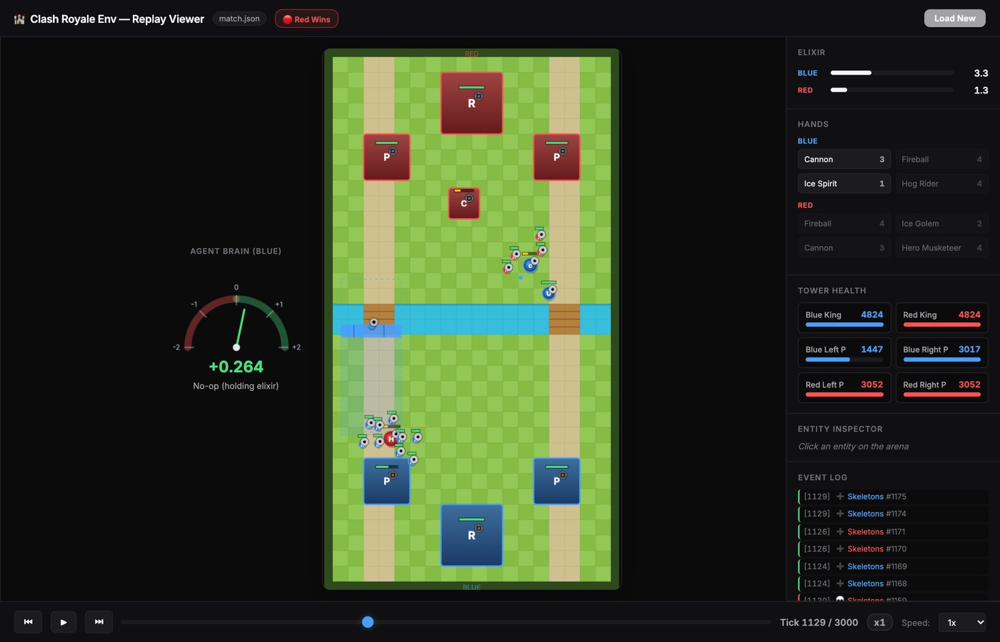
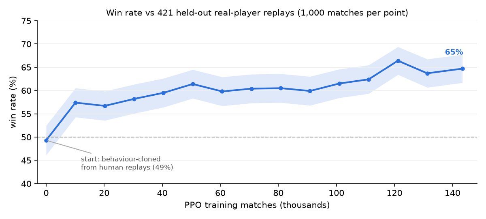
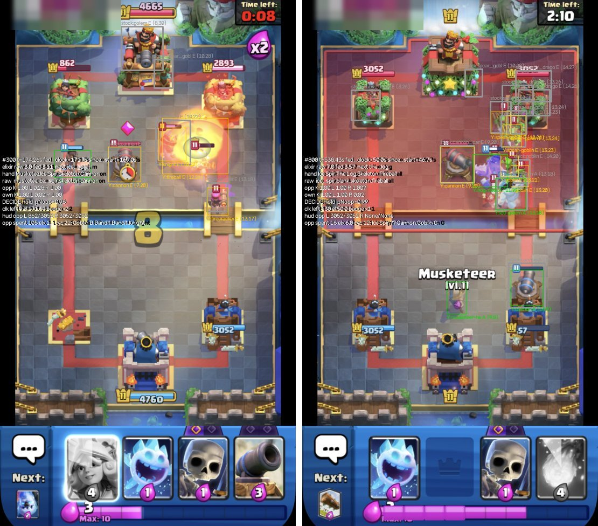

# Clash Royale agent: simulator, training, live play

A Hog 2.6 agent trained in a C++ Clash Royale simulator. It learns first from
recorded human matches (behaviour cloning), then improves with PPO against a
pool of opponents. The same policy can then play the real game on an iPhone
through screen capture and a unit detector.


*A simulated match in `engine/web/viewer.html`. Our agent (bottom) plays Hog 2.6. Each tick carries the policy's value estimate and the card it chose.*

```
IL_Replay human matches ──► behaviour cloning ──► PPO vs opponent pool ──► evaluation ──► live play
 (Hugging Face)             training/bc_train     (teacher, BC clone,      against 421      (iPhone mirroring,
                                                   real-player replays,     held-out         YOLO detector,
                                                   own snapshots;           real-player      play_live.py)
                                                   sim-to-real noise)       replays
```

| Piece | Where |
|---|---|
| Simulator (C++, pybind11), scripted teacher, replay viewer | `engine/`, a submodule pointing at our fork [sjdoane/ClashRoyaleAi](https://github.com/sjdoane/ClashRoyaleAi) on branch `gen2` |
| Our engine changes (stat audit, timing, body sizes, pathing and more) | `patches/` (already applied on the fork; see `patches/README.md`) |
| Training: data builders, BC, PPO, opponent pool, rewards, sim-to-real | `training/` |
| Evaluation scripts and configs | `training/eval_ghost.py`, `evals/` |
| Live play: capture, detection, state estimate, taps | `play_live.py`, `live_ppo/`, `ios/` |
| Detector training data tools | `video_dataset/` |
| Notes from the live sessions and the training plan | `docs/notes/` |

## Quick start (a few minutes, macOS or Linux)

You need `git`, [`uv`](https://docs.astral.sh/uv/) and `cmake` (on macOS: `brew install uv cmake`).

```bash
git clone --recurse-submodules https://github.com/sjdoane/clash-royale-project.git
cd clash-royale-project
./setup.sh                      # Python 3.11 venv, builds the simulator module
scripts/fetch_assets.sh         # trained weights (private repo: ask Sam for access)
.venv/bin/python play_sim.py    # one match against the scripted teacher
```

`play_sim.py` prints the result and saves `replays/match.json`. To watch it,
open `engine/web/viewer.html` in a browser, click **Choose File** and pick the
replay.

```bash
.venv/bin/python play_sim.py --games 50                  # win rate over 50 seeds
.venv/bin/python play_sim.py --rung 10                   # strongest teacher (0 = passive)
.venv/bin/python play_sim.py --deck "golem,night witch,baby dragon,lumberjack,tornado,lightning,barbarian barrel,mega minion"
.venv/bin/python play_sim.py --weights checkpoints/bc_init.pth   # the behaviour clone, before PPO
```

The assets (private release, about 120 MB):

| File | What it is |
|---|---|
| `ppo_latest.pth` | PPO, episode 143,398, the latest snapshot |
| `ppo_ep0121202.pth` | PPO, episode 121,202, the one we deployed live |
| `bc_init.pth` | Behaviour clone of Hog 2.6 players; PPO starts from it |
| `bc_clone_any.pth` | Behaviour clone of all players; an opponent in the pool |
| `detector_r3.pt` | YOLO unit detector for live play (`--no-det` skips it) |
| `meta_api_pool.json` | Current meta decks from the official API, used as opponent decks |

`ppo_latest.pth` against the scripted teacher (30 matches each):
rung 3 80%, rung 6 33%, rung 10 37%. The teacher was only a small part of
training (10% of the opponent pool), so this is a sanity check, not the
headline number.

## Results



Each point is 1,000 simulated matches against 421 held-out replays of real
matches in which one player used Hog 2.6. The agent takes that player's seat
and the opponent replays its recorded moves.

| Policy | vs held-out replays | under live conditions* |
|---|---|---|
| BC clone (`bc_init.pth`) | 49.3% | |
| PPO ep 50,513 | 61.4% | |
| PPO ep 121,202 (deployed) | **66.4%** | 67.7% |
| PPO ep 143,398 (latest) | 64.7% | |

\*Observation noise, an estimated elixir bar, act delay and sampling
temperature, as the live driver sees and acts.

**The simulator result does not carry over to the real game yet: 0 wins
in 21 live matches on the iPhone against real players.** Replays
are easier than real opponents, because a replay cannot react. The live
perception also misses units. The live failure analysis is in
`docs/notes/LIVE.md`.

## Evaluate

```bash
scripts/build_data.sh ghosts    # once: replay opponents and deck pools (1.8 GB download, then about 2 min)
.venv/bin/python -m training.eval_ghost --weights checkpoints/ppo_latest.pth --label latest \
    --n 1000 --procs 8 --tail-noise spells --no-human --out evals/latest.json
evals/tools/eval_pair.sh checkpoints/ppo_latest.pth latest 20261123   # clean plus three live conditions
```

`play_sim.py --games N` needs no data and is the quickest check against the
scripted teacher.

## Train

```bash
scripts/build_data.sh ghosts    # needed for PPO
scripts/build_data.sh bc        # only to retrain BC or use PPO's cloning loss (hours, about 46 GB)

# behaviour cloning (the released clones are bc_init = ep4 and bc_clone_any = ep5)
.venv/bin/python -m training.bc_train --data data/bc2/hog_g2 --name g2_big_L0_H10 --lead 0 --what-h 10 \
    --epochs 12 --core-hidden 1024 --core-layers 3
.venv/bin/python -m training.bc_train --data data/bc2/all_g2 --name all_big_L0_H10 --groups all --lead 0 \
    --what-h 10 --epochs 6 --core-hidden 1024 --core-layers 3

# PPO from bc_init.pth against the opponent pool (resumes automatically, SIGTERM saves)
NO_BC=1 DEVICE=mps NUM_ENVS=12 RUN=my_run training/run_g2_ppo_s2r.sh   # DEVICE=cuda on a GPU box
tail -f runs/logs/my_run.log
```

The original run took about 12 hours on an Apple-silicon Mac to reach episode 120k.
Snapshots go to `runs/<run>/snapshots/`, and `play_sim.py --weights` or
`eval_ghost` take any of them. The header of `training/run_g2_ppo_s2r.sh`
explains every flag and change during the run. `training/README.md`,
`training/SIM2REAL_REPORT.md` and `docs/notes/TRAINING_PLAN.md` cover the
design.

Tests: `.venv/bin/python -m pytest training/tests -q`. Run
`scripts/build_data.sh ghosts` first, because about ten tests read
`data/ghost/v1`. One test is a known open failure, marked xfail.

To change the simulator, edit `engine/` (fork branch `gen2`) and rebuild with
`./setup.sh`. A gameplay change makes old win rates incomparable.

## Live play (iPhone, Training Camp or a friendly only)


*Two frames from a live match. Boxes are detector output, the panel shows the state the policy sees and its chosen card and tile. Player names are blurred.*

The phone screen is captured through macOS iPhone Mirroring. The detector and
the state estimator turn each frame into the simulator's observation, and the
policy's play is tapped back through the mirroring window. Clash Royale
blocks emulators, so a real phone is required.

```bash
./setup.sh --live                       # detector venv
# one-time phone setup: ios/SETUP.md
.venv/bin/python play_live.py          # watch only, no taps (policy: checkpoints/ppo_ep0121202.pth)
.venv/bin/python play_live.py --act    # plays
```

Use it only in Training Camp or a friendly match the other player agreed to.
Never use it on ladder. `docs/notes/LIVE.md` has the options, the
dump/replay tools and what went wrong in each session.

## Data and licensing

Training data comes from the IL_Replay dataset on Hugging Face, which has no
licence. It is not in this repository or the assets release.
`scripts/build_data.sh` downloads it and rebuilds everything derived from it
on your machine. Keep it private. Our recordings of live matches are not
shipped either, because they contain other players. The meta-deck list comes
from the official Clash Royale API.
